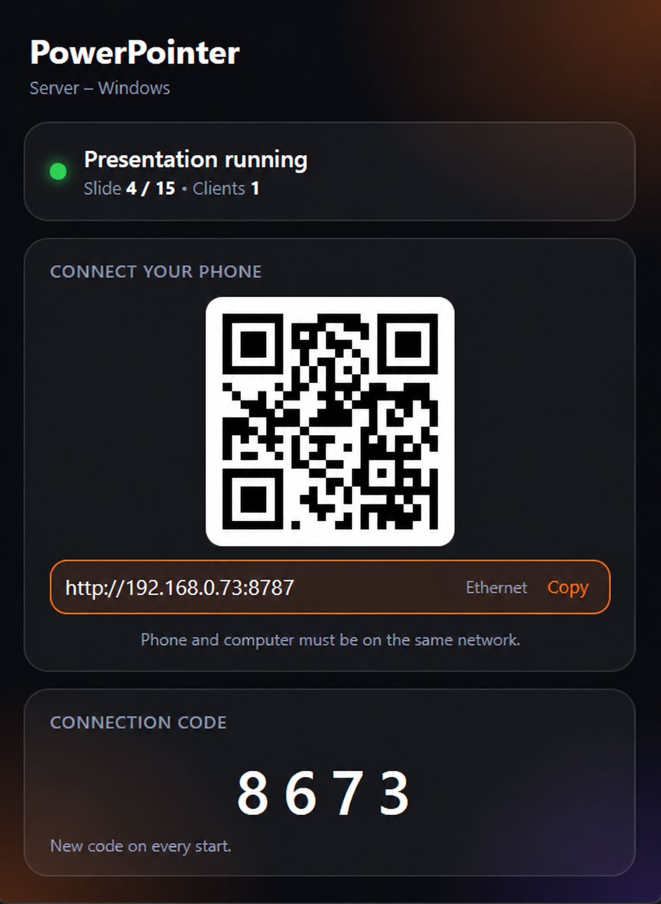
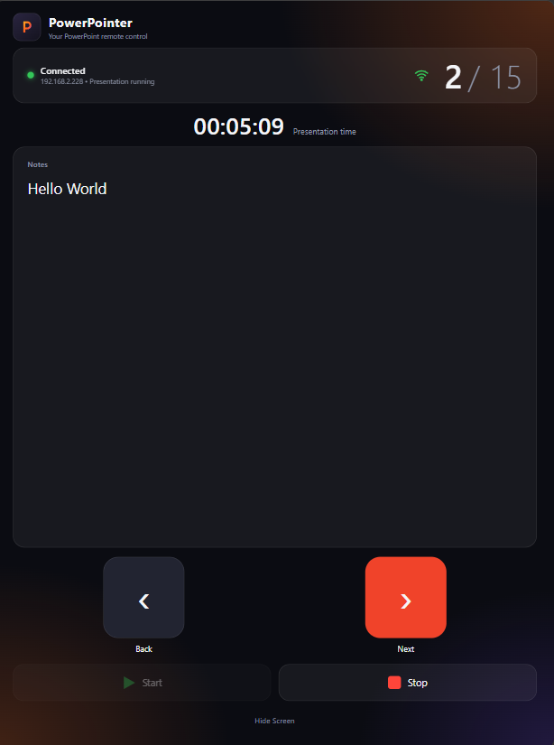
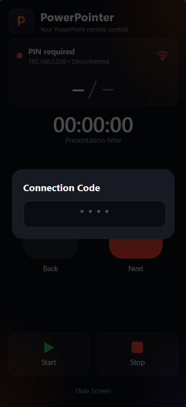
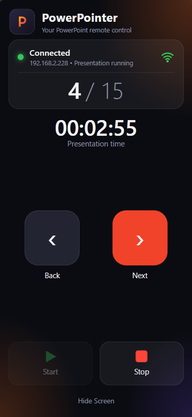

# PowerPointer

PowerPointer turns your phone or tablet into a remote control for Microsoft PowerPoint. The Node.js server runs on the computer with PowerPoint, and the mobile device opens the address shown by the server in its browser. No additional app or cloud connection is required.

Ready-made installers are available for **Windows (`.exe`)** and **macOS (`.dmg`)** on the [Releases page](https://github.com/MartHafner/PowerPointer/releases/latest). You do not need Node.js or Git for them. See [Download the Installer](#download-the-installer-windows-and-macos).

## Table of Contents
- [Pictures](#pictures)
- [Features](#features)
- [Requirements](#requirements)
- [Download the Installer (Windows and macOS)](#download-the-installer-windows-and-macos)
- [Quick Start (from Source)](#quick-start-from-source)
- [Download and Install from GitHub](#download-and-install-from-github)
  - [Install the Required Software](#install-the-required-software)
  - [Windows](#windows)
  - [macOS](#macos)
  - [Alternative: Download the ZIP Archive](#alternative-download-the-zip-archive)
  - [Updating](#updating)
- [Start Options](#start-options)
- [Desktop App](#desktop-app)
  - [Build Installers](#build-installers)
  - [Releases via GitHub Actions](#releases-via-github-actions)
- [Connect Your Phone and Stop the Server](#connect-your-phone-and-stop-the-server)
- [Add the Remote to the iPhone Home Screen](#add-the-remote-to-the-iphone-home-screen)
- [Using a Personal Hotspot](#using-a-personal-hotspot)
- [PowerPoint Permissions](#powerpoint-permissions)
- [Using the Remote](#using-the-remote)
- [Configuration](#configuration)
  - [Environment Variables](#environment-variables)
  - [Demo Mode](#demo-mode)
  - [Debugging](#debugging)
- [How It Works](#how-it-works)
- [Network and Security](#network-and-security)
- [Known Limitations](#known-limitations)
- [Troubleshooting](#troubleshooting)
- [Project Structure](#project-structure)
- [License](#license)

## Pictures

### Desktop view
<p align="center">
   
</p>

### iPad view
<p align="center">
   
</p>

### iPhone view
<p align="center">
   
   
</p>

## Features

- Start and stop a presentation
- Move to the previous or next slide
- Turn the presentation screen black and restore it
- Display the current slide, total slide count, and elapsed time
- Display speaker notes on tablet-sized screens (viewport width of 700 px or more)
- Display the connection and PowerPoint status
- Use touch, keyboard, or a Bluetooth clicker to control the presentation
- Keep the phone screen awake while the remote is open (where the browser supports the Screen Wake Lock API) and give short haptic feedback on button presses (where the browser supports vibration)
- Protect the WebSocket control connection with a randomly generated session PIN by default, including rate limiting against PIN guessing
- Show status, connected clients, PIN, addresses, and a QR code in an optional desktop dashboard
- Run as a headless server (`npm run server`) or as an Electron desktop app
- Install with a ready-made Windows installer (`.exe`) or macOS disk image (`.dmg`) from GitHub Releases, no Node.js required
- Use a demo mode that simulates a presentation without PowerPoint

## Requirements

- Node.js and npm:
  - **Desktop app and `npm start`:** Node.js 22.12 or later (required by Electron 45)
  - **Headless server only (`npm run server`):** Node.js 18 or later
- Microsoft PowerPoint for actual presentation control
- The computer and mobile device must be connected to the same local network
- macOS or Windows for platform-specific PowerPoint control

PowerPointer can also run without PowerPoint in demo mode. On other operating systems, the server automatically uses this mode.

If you only have Node.js 18 to 20, install without the Electron development dependency and use the headless server:

```sh
npm ci --omit=dev
npm run server
```

## Download the Installer (Windows and macOS)

The easiest way to use PowerPointer is the prebuilt installer. It already contains the server and the desktop dashboard, so **Node.js, npm, and Git are not needed**. You only need Microsoft PowerPoint and a shared local network with your phone.

1. Open the [latest release](https://github.com/MartHafner/PowerPointer/releases/latest) on GitHub.
2. Under **Assets**, download the file for your system:
   - **Windows:** the `.exe` setup file (named like `PowerPointer Setup <version>.exe`)
   - **macOS:** the `.dmg` disk image (named like `PowerPointer-<version>.dmg`)
3. Install it as described below and start **PowerPointer**.
4. Open one of the addresses shown in the dashboard (or scan its QR code) in your phone's browser and enter the connection code.

### Windows (`.exe`)

1. Run the downloaded setup file.
2. The installer is not code-signed, so Windows SmartScreen may show "Windows protected your PC". Click **More info**, then **Run anyway**.
3. Follow the installer and start PowerPointer from the Start menu or desktop shortcut.
4. If Windows Defender Firewall asks whether to allow PowerPointer on the network, allow it for **private networks**. Otherwise the phone cannot reach the server.
5. Start PowerPoint and open a presentation. Run PowerPoint and PowerPointer both as a normal user.

### macOS (`.dmg`)

1. Open the downloaded `.dmg` file and drag **PowerPointer** into the **Applications** folder.
2. The app is neither code-signed nor notarized, so Gatekeeper may block the first launch. Right-click (or Control-click) the app in **Applications**, choose **Open**, and confirm. If macOS still refuses, go to **System Settings → Privacy & Security** and click **Open Anyway** for PowerPointer.
3. Allow PowerPointer to control PowerPoint under **System Settings → Privacy & Security → Automation** (macOS asks on first use).
4. If the page cannot be reached from the phone, allow incoming connections for PowerPointer under **System Settings → Network → Firewall → Options**.
5. Closing the dashboard window keeps the server running; quit with **Cmd+Q** to stop it.

The `.dmg` is built on a macOS runner on GitHub and may only run on the processor architecture it was built for. If it does not start on your Mac, [build it yourself](#build-installers) or run PowerPointer from source.

### Updating the installed app

The desktop app checks for updates from GitHub Releases when it starts:

- **Windows:** Official release builds download updates automatically and install them when you quit PowerPointer. If an update is not applied, download and run the latest `.exe` installer from the [Releases page](https://github.com/MartHafner/PowerPointer/releases/latest).
- **macOS:** PowerPointer notifies you when a newer release is available. Choose **Open download page**, download the latest `.dmg`, and install it manually.

Windows automatic updates are only enabled in packaged builds published through the GitHub release workflow. The macOS desktop app checks GitHub Releases and shows a notice, but does not install updates automatically. Source and headless server installations must be updated manually. An update may replace settings such as a fixed PIN or custom port in the installed app; back up your settings before updating.

## Quick Start (from Source)

```sh
git clone https://github.com/MartHafner/PowerPointer.git
cd PowerPointer
npm ci
npm start
```

If you do not want to install Node.js, use the [prebuilt installer](#download-the-installer-windows-and-macos) instead. Then open one of the addresses shown in the dashboard in your phone's browser and enter the four-digit connection code. To try it without PowerPoint, use `npm run dev` (see [Demo Mode](#demo-mode)). Detailed, platform-specific instructions follow below.

## Download and Install from GitHub

### Install the Required Software

- **Node.js 22.12 or later** (18 or later if you only use the headless server), including npm. Download and install the current LTS release from [nodejs.org](https://nodejs.org/).
- **Git**, if you want to clone the repository using `git clone`. Download it from [git-scm.com](https://git-scm.com/downloads).
- Microsoft PowerPoint for actual presentation control.
- The computer and mobile device on the same local network.

After installation, check that Node.js and npm are available:

```sh
node --version
npm --version
```

Both commands should print version numbers. If they do not, close and reopen the terminal. If the commands are still not found, check your Node.js installation.

### Windows

1. Install Node.js and Git (see above).
2. Open **PowerShell**.
3. Change to the folder where you want to keep the project, then clone the repository:

   ```powershell
   cd $HOME\Documents
   git clone https://github.com/MartHafner/PowerPointer.git
   cd PowerPointer
   ```

4. Install the exact project dependencies:

   ```powershell
   npm ci
   ```

5. Start PowerPointer (this opens the desktop dashboard):

   ```powershell
   npm start
   ```

6. The dashboard shows the local addresses, a QR code, and the connection code. Open one of the addresses in the browser on your phone. To run without the dashboard, use `npm run server` instead and keep the PowerShell window open; the addresses are then printed there.
7. If Windows Defender Firewall asks whether to allow Node.js or PowerPointer on the network, allow it for **private networks**. Otherwise the phone cannot reach the server.

### macOS

1. Install Node.js. Git is often already available; if macOS prompts you, install the offered Xcode Command Line Tools.
2. Open **Terminal**.
3. Change to the folder where you want to keep the project, then clone the repository:

   ```sh
   cd ~/Documents
   git clone https://github.com/MartHafner/PowerPointer.git
   cd PowerPointer
   ```

4. Install the project dependencies:

   ```sh
   npm ci
   ```

   Alternatively, double-click `install.command` in the project folder. It checks that Node.js 22.12 or later is installed, runs `npm install`, and offers to start PowerPointer afterwards. If macOS blocks the script because it was downloaded from the internet, right-click it, choose **Open**, and confirm.

5. Start PowerPointer (this opens the desktop dashboard):

   ```sh
   npm start
   ```

6. Open one of the addresses shown in the dashboard in your phone's browser. To run without the dashboard, use `npm run server` instead and keep the Terminal window open; the addresses are then printed there.

### Alternative: Download the ZIP Archive

You can download the project without installing Git:

1. Open the [latest release of PowerPointer](https://github.com/MartHafner/PowerPointer/releases/latest) on GitHub.
2. Under **Assets**, download **Source code (zip)**.
3. Extract the downloaded ZIP archive to a folder of your choice.
4. Open Terminal (macOS) or PowerShell (Windows) in the extracted project folder. This folder contains `package.json`.
5. Run the following commands:

   ```sh
   npm ci
   npm start
   ```

   The same commands work in PowerShell.

### Updating

- **Git:** Run `git pull` and `npm ci` in the project folder, then restart PowerPointer.
- **ZIP:** Download the [latest release](https://github.com/MartHafner/PowerPointer/releases/latest), extract it to a new folder, copy your `config/settings.json` from the old folder, and run `npm ci` and `npm start`.

## Start Options

| Command | What it does |
|---|---|
| `npm start` | Starts the desktop app (Electron dashboard) and the server. Terminal output appears only when `DEBUG` is set. |
| `npm run desktop` | Same as `npm start`. |
| `npm run server` | Starts only the server without a dashboard. Prints addresses, a QR code, and the PIN in the terminal. |
| `npm run dev` | `npm start` in [demo mode](#demo-mode). |
| `npm run desktop:dev` | Same as `npm run dev`. |
| `npm run server:dev` | `npm run server` in demo mode. |
| `npm run debug` | `npm start` with [debug logging](#debugging). |
| `npm run build:win` | Builds the Windows NSIS installer (x64) into `dist/`. See [Build Installers](#build-installers). |
| `npm run dist` | Builds installers for the current operating system into `dist/` without publishing. |
| `node server/pin.js` | Prints a freshly generated random four-digit PIN (helper for choosing a fixed PIN). |

The package also registers a `powerpointer` binary that points to `server/server.js`, so the headless server can be started as a command when the package is installed globally or linked.

## Desktop App

PowerPointer includes an optional Electron desktop app. It starts the server and opens a dashboard showing the PowerPoint status, current slide, connected clients, connection PIN, and local network addresses. Select an address to display its QR code, or copy it to the clipboard to open it on your phone.

Install the project dependencies as described above, then start the desktop app from the project folder:

```sh
npm start
```

`npm run desktop` does the same. You do not need to start the server separately; the desktop app starts it for you. Only one instance can run at a time: starting PowerPointer a second time brings the existing window to the front. If the configured port is already in use, the app shows an error message and quits.

On macOS, closing the dashboard window leaves the server running; use **Cmd+Q** to quit the app and stop the server. Clicking the Dock icon reopens the dashboard. On Windows, closing the window stops the app and server.

The dashboard window adjusts its height to its content and never grows beyond the usable screen area.

### Build Installers

This section is for developers who want to create the `.exe` / `.dmg` themselves. If you only want to use PowerPointer, download the finished installers from the [Releases page](https://github.com/MartHafner/PowerPointer/releases/latest) (see [Download the Installer](#download-the-installer-windows-and-macos)).

Installers are built with [electron-builder](https://www.electron.build/). Build on the operating system you are targeting.

**Windows** (Node.js 22.12 or later):

```powershell
npm ci
npm run build:win
```

The x64 NSIS setup executable is created in `dist/`. It is not code-signed, so Windows may show a SmartScreen warning. A signing certificate is needed for a signed public release.

**macOS** (Node.js 22.12 or later):

```sh
npm ci
npm run dist
```

The `.dmg` image is created in `dist/`. It is neither code-signed nor notarized, so macOS Gatekeeper may block the first launch. Right-click the app, choose **Open**, and confirm. Proper distribution requires an Apple Developer ID certificate and notarization.

The installer icons are taken from `desktop/assets/` (`icon.ico` for Windows, `icon.png` for macOS). Make sure these files exist before building.

### Releases via GitHub Actions

The workflow in `.github/workflows/build.yml` builds the macOS and Windows installers on GitHub's runners (Node.js 22, `npm ci`, `npm run dist`). It runs

- when a tag starting with `v` is pushed (for example `v2.0.1`), and
- when started manually from the **Actions** tab (`workflow_dispatch`).

The resulting `.dmg` and `.exe` files are uploaded as workflow artifacts. For tag builds, they are also attached to a GitHub release. To publish a release:

```sh
git tag v2.0.1
git push origin v2.0.1
```

Keep the tag in sync with the `version` in `package.json`.

## Connect Your Phone and Stop the Server

Connect your phone and computer to the same local network, then open one of the addresses in your phone's browser, for example `http://192.168.1.23:8787`. You can find the addresses in the desktop dashboard (select one to show its QR code) or, when running `npm run server`, in the terminal together with a QR code for the first address. Private network addresses (such as `192.168.x.x` or `10.x.x.x`) are listed first.

On first load, the web interface asks for the four-digit connection code (PIN) shown on the computer. Once the code is accepted, the control interface is unlocked.

macOS: If the page cannot be reached, allow node to accept incoming connections under System Settings → Network → Firewall → Options.

Windows: If the page cannot be reached, make sure the firewall allows Node.js or PowerPointer on private networks.

Stop the server by quitting the desktop app (Cmd+Q on macOS, closing the window on Windows) or, when using `npm run server`, by pressing `Ctrl+C` in the Terminal or PowerShell window where it is running.

## Add the Remote to the iPhone Home Screen

The web interface is prepared to run as a full-screen web app. In Safari, open the PowerPointer address, tap **Share**, and choose **Add to Home Screen**. Note that the address changes if the computer receives a different IP address from your router, and that the PIN is requested again for every new session (a generated PIN also changes on every server start).

## Using a Personal Hotspot

If you are on an untrusted or shared network (for example, at a conference), you can use your phone's personal hotspot instead:

1. On your iPhone, turn on **Settings → Personal Hotspot**.
2. Connect the computer to your iPhone's Wi-Fi network.
3. Start PowerPointer and open the address shown in the dashboard (or printed in the terminal) in your iPhone's browser. The address usually starts with `172.20.10.` when using an iPhone hotspot.

If the computer has several network connections, several addresses are listed. Use the one that matches the hotspot network. In the dashboard you can select the address whose QR code you want to scan; the terminal QR code uses only the first address.

## PowerPoint Permissions

- **macOS:** Allow the application that launched PowerPointer (for example, Terminal or the Electron app) to control PowerPoint under **System Settings → Privacy & Security → Automation**.
- **Windows:** PowerPoint must be installed and running with a presentation open. PowerPointer connects to the running instance using PowerShell and COM automation. Run PowerPoint and PowerPointer at the same privilege level (both as a normal user); a PowerPoint started "as administrator" usually cannot be reached from a normal process.

## Using the Remote

Use the buttons to control the presentation. While it is running, the interface displays the current slide, the total number of slides, and elapsed time. On tablet-sized screens, the speaker notes of the current slide are shown as well. The timer starts when a running slide show is first detected and is reset when the slide show ends.

Keyboard shortcuts:

| Key | Action |
|---|---|
| Right arrow, Page Down, or Space | Next slide |
| Left arrow or Page Up | Previous slide |
| `b` or `.` | Turn the screen black or restore it |

The shortcuts are inactive while the PIN dialog is open. Most Bluetooth clickers send Page Up / Page Down or arrow keys and therefore work out of the box when paired with the phone or tablet.

Status messages:

| Message | Meaning |
|---|---|
| Presentation running | A slide show is running. |
| Screen hidden | The slide show is running and the screen is black. |
| Ready – no presentation active | PowerPoint is open, but no slide show is running. Use **Start**. |
| PowerPoint is not open | PowerPoint is not running. |
| PowerPoint not reachable / Error: … | The server could not talk to PowerPoint, for example because of missing permissions. |

The server checks PowerPoint's status every 500 milliseconds (twice per second) by default. If the connection is lost, the web interface automatically tries to reconnect with an increasing delay (up to 5 seconds).

## Configuration

Settings are stored in [`config/settings.json`](config/settings.json):

| Setting | Default | Description |
|---|---:|---|
| `port` | `8787` | HTTP and WebSocket port |
| `host` | `0.0.0.0` | Network address the server listens on |
| `pin` | `"auto"` | Generate a random four-digit PIN when the server starts; set to `""` to disable PIN protection |
| `pollIntervalMs` | `500` | Interval between PowerPoint status checks, in milliseconds (if the setting is missing, the server falls back to 1000) |

The generated PIN is shown in the desktop dashboard (or printed in the terminal when running `npm run server`) and remains valid until the server stops. Set `pin` to a fixed value to use a custom PIN. The web interface only accepts exactly four digits, so a fixed PIN must consist of four digits (for example `"1234"`); longer or non-numeric PINs cannot be entered on the phone. Example for PowerShell:

```powershell
$env:POWERPOINTER_PIN = "1234"
npm start
```

The web interface prompts for the PIN when connecting. It is stored for the current browser tab session.

### Environment Variables

| Variable | Description |
|---|---|
| `PORT` | Overrides `port` from `settings.json`. |
| `POWERPOINTER_PIN` | Overrides `pin` from `settings.json`. Use `auto` for a random PIN or an empty value to disable PIN protection. |
| `POWERPOINTER_MOCK` | Any non-empty value except `0` or `false` enables [demo mode](#demo-mode). |
| `DEBUG` | `1` or `true` enables [debug logging](#debugging); `0` and `false` keep it off. |

### Demo Mode

Demo mode simulates a presentation with ten slides. Start, stop, next, previous, and hide-screen work as usual, and the notes show a placeholder text. On macOS and Windows, enable it with the `POWERPOINTER_MOCK` environment variable:

```sh
POWERPOINTER_MOCK=1 npm start
```

In PowerShell:

```powershell
$env:POWERPOINTER_MOCK = "1"
npm start
```

The `npm run dev` script enables the same mode in shells that support Unix-style environment variable assignment. On other operating systems, demo mode is selected automatically.

### Debugging

Debug logging adds timestamps and details about server startup and shutdown, TCP and HTTP connections, WebSocket connections and messages, and process warnings. With `npm start`, the terminal UI (addresses, QR code, PIN) is normally hidden; enabling debug mode shows it together with the log output. To enable it on macOS or Linux, run:

```sh
DEBUG=1 npm start
```

The `npm run debug` script does the same on shells that support Unix-style environment variable assignment. In PowerShell, use:

```powershell
$env:DEBUG = "1"
npm start
```

`DEBUG=0` and `DEBUG=false` keep debug mode off. Debug output appears in the same terminal as the server. HTTP and WebSocket URLs have their PIN masked, but WebSocket message contents are logged. Avoid sharing debug logs publicly; to return to normal logging in PowerShell, run `Remove-Item Env:DEBUG` before starting the server again.

## How It Works

```text
Phone / tablet browser  <--HTTP + WebSocket-->  Node.js server  <--AppleScript / PowerShell COM-->  PowerPoint
```

1. The server serves the static web interface from `public/` over HTTP.
2. The browser opens a WebSocket connection to `/ws`, passing the PIN as a query parameter.
3. After successful authentication, the server sends the current state (`connected`, `state`, `slide`, `total`, `blank`, `notes`, `startedAt`, `error`).
4. The server polls PowerPoint at the configured interval and broadcasts a message to all clients whenever the state changes. Speaker notes are only queried when the slide changes or the slide show starts.
5. Clients send commands such as `{"type":"command","command":"next"}`. The server accepts only `next`, `prev`, `start`, `stop`, and `blank`, executes the matching platform call, and immediately refreshes the state.

On macOS, PowerPoint is controlled with AppleScript (`osascript`); on Windows, with PowerShell and the PowerPoint COM interface. Each call has a timeout (8 s on macOS, 10 s on Windows), so an unresponsive PowerPoint cannot block the server.

## Network and Security

The web interface and control connection are intended for use on a trusted local network. The server rejects connections from non-local IP addresses (private IPv4 ranges, link-local addresses, loopback, and the IPv6 equivalents). It answers only `GET` and `HEAD` requests, serves only the files in `public/` (path traversal is blocked), and limits WebSocket messages to 1 KB. Clients can only trigger a fixed set of commands: `next`, `prev`, `start`, `stop`, and `blank`.

The PIN protects the WebSocket control connection, not the static web page itself. The page contains no presentation data, but anyone on the local network can load it; without the PIN they cannot receive status or send commands. The PIN is compared in constant time, and generated PINs use a cryptographically secure random number generator.

The default PIN is random and changes each time the server starts, but it has only four digits and is displayed in the dashboard or server terminal. To slow PIN guessing, five incorrect PIN attempts from the same client IP trigger a lockout. The first lockout lasts one minute; subsequent lockouts double in duration up to a maximum of 15 minutes. During a lockout, even the correct PIN is rejected. An attempt to connect without a PIN does not count as a failed attempt, and a successful connection resets the failed-attempt and lockout history for that IP. This rate limit is held in memory and resets when the server restarts.

A PIN protects the WebSocket control connection but does not encrypt it. By default, PowerPointer uses HTTP and WebSocket without TLS, so someone able to monitor local network traffic may capture the PIN and presentation data (including speaker notes). Do not expose the server port to the public internet, and only use PowerPointer on networks you trust. Setting `pin` to an empty value disables PIN protection.

The desktop dashboard runs in a sandboxed Electron window with context isolation, without Node.js integration, and with a restrictive Content Security Policy. Navigation and new windows are blocked, and the preload bridge only exposes a small set of functions whose calls are accepted from the dashboard window only.

## Known Limitations

- Only the first open slide show window is controlled.
- Notes are shown only on tablet-sized screens and only while a slide show is running.
- The PIN is limited to four digits on the web interface.
- No TLS; see [Network and Security](#network-and-security).
- The `.exe` and `.dmg` installers are not code-signed or notarized, so Windows SmartScreen and macOS Gatekeeper show warnings on first launch.
- Update behavior depends on the platform: Windows release builds update automatically when the app is quit; macOS only shows an update notice and requires manual installation. See [Updating the installed app](#updating-the-installed-app).

## Troubleshooting

| Problem | Solution |
|---|---|
| The page does not load on the phone | Make sure phone and computer are on the same network, use an address shown by PowerPointer, and check the firewall (see [Connect Your Phone](#connect-your-phone-and-stop-the-server)). Some guest or hotel networks isolate devices from each other; use a [personal hotspot](#using-a-personal-hotspot) instead. |
| "Nur im lokalen Netzwerk erreichbar." (HTTP 403) | The request came from a non-local IP address. Connect from the same local network. VPN connections can cause this. |
| "Port 8787 is already in use" | PowerPointer may already be running. Quit it, or change `port` in `config/settings.json` or set the `PORT` environment variable. |
| "Wrong PIN" or "Locked" | Enter the PIN currently shown in the dashboard or terminal. After five wrong attempts, wait for the lockout to end (1 to 15 minutes) or restart the server. |
| The PIN dialog does not accept my custom PIN | The web interface accepts exactly four digits. Use a four-digit `pin`. |
| The PIN changed and the remote no longer connects | A generated PIN is new on every server start. Reload the page and enter the new code, or set a fixed four-digit `pin`. |
| "PowerPoint is not open" | Start PowerPoint and open a presentation. |
| "PowerPoint not reachable" or an automation error (macOS) | Allow the launching application to control PowerPoint under **System Settings → Privacy & Security → Automation**. |
| "PowerPoint not reachable" (Windows) | Make sure PowerPoint is running with a presentation open, that PowerPoint and PowerPointer run at the same privilege level (not one as administrator), and that PowerShell is available. |
| Speaker notes are not shown | Notes are displayed only on tablet-sized screens (width of 700 px or more) and only while a slide show is running. |
| `npm ci` or Electron fails on an older Node.js version | Electron 45 requires Node.js 22.12 or later. Update Node.js, or use `npm ci --omit=dev` and `npm run server`. |
| macOS says the downloaded app or script cannot be opened | The app is not notarized. Right-click it, choose **Open**, and confirm. |
| Windows SmartScreen warns about the installer | The installer is not code-signed. Choose **More info → Run anyway** if you trust the source. |
| The installed app (`.exe` / `.dmg`) does not start | Check [Download the Installer](#download-the-installer-windows-and-macos): confirm the SmartScreen or Gatekeeper warning, and make sure no other PowerPointer instance is running on the same port. |
| Nothing to try without PowerPoint | Use the [demo mode](#demo-mode). |

## Project Structure

```text
PowerPointer/
├── .github/
│   └── workflows/
│       └── build.yml
├── config/
│   └── settings.json
├── desktop/
│   ├── assets/
│   │   └── icon.svg (plus icon.png / icon.ico for the installers)
│   ├── main.js
│   ├── panel.css
│   ├── panel.html
│   ├── panel.js
│   └── preload-panel.js
├── public/
│   ├── assets/
│   │   └── icon.svg
│   ├── app.js
│   ├── index.html
│   └── style.css
├── server/
│   ├── platforms/
│   │   ├── macos.js
│   │   └── windows.js
│   ├── network.js
│   ├── debug.js
│   ├── pin.js
│   ├── ratelimit.js
│   ├── powerpoint.js
│   └── server.js
├── .gitignore
├── install.command
├── LICENSE
├── package.json
└── package-lock.json
```

- `server/server.js` serves the web interface and manages HTTP, WebSocket, and status connections.
- `server/network.js` discovers local IPv4 addresses and checks whether a client is on a local network.
- `server/debug.js` provides optional timestamped logging when `DEBUG` is enabled.
- `server/pin.js` generates the random session PIN.
- `server/ratelimit.js` limits repeated incorrect PIN attempts per client IP.
- `server/powerpoint.js` provides the shared command interface and demo mode.
- `server/platforms/` contains the PowerPoint integrations using AppleScript (macOS) and PowerShell/COM (Windows).
- `desktop/` contains the optional Electron app and its connection dashboard.
- `public/` contains the remote-control interface.
- `config/settings.json` contains the server settings.
- `install.command` is a macOS installation script.
- `.github/workflows/build.yml` builds the installers and creates releases for version tags.

## License

This project is licensed under the [MIT License](LICENSE). Copyright (c) 2026 Schildkobold.