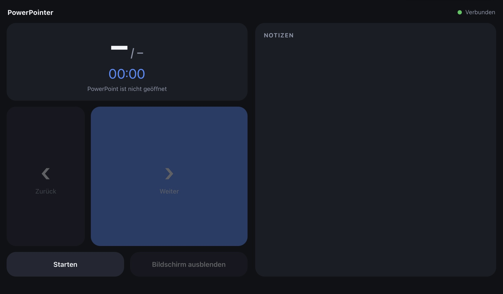
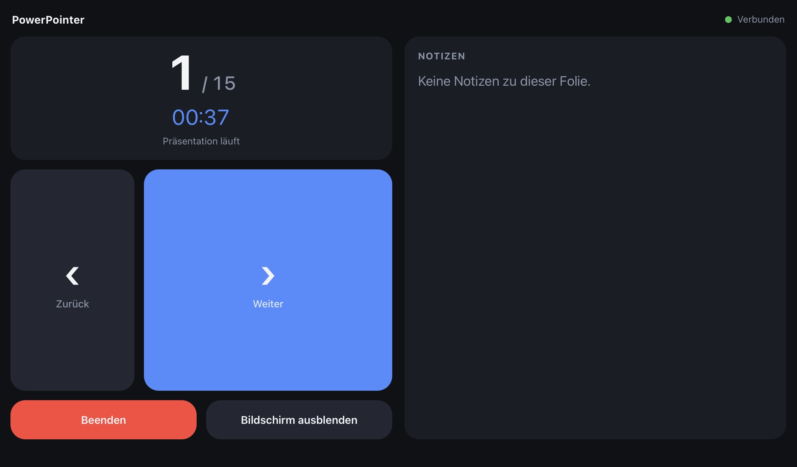
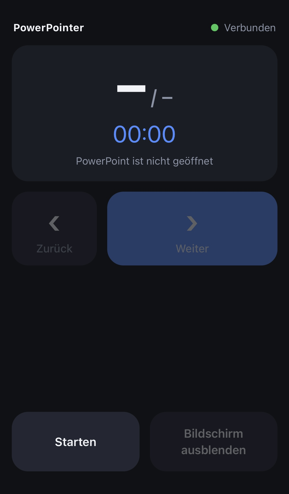

# PowerPointer

PowerPointer turns an iPhone, iPad, or other phone or tablet into a remote control for Microsoft PowerPoint. Run the Node.js server on the computer that has PowerPoint open, then connect from a browser on the same local network. No mobile app or cloud connection is required.

The optional Electron desktop app provides a local dashboard with connection addresses, a QR code, the session PIN, and presentation status.

## Features

- Start and stop a slide show; navigate forward and backward.
- Blank the presentation screen and restore it.
- Show the current slide, total slide count, and elapsed time.
- Display speaker notes on screens at least 700 px wide.
- Control the presentation with touch, keyboard, or a Bluetooth clicker.
- Connect with a randomly generated session PIN by default.
- Run a simulated presentation without PowerPoint using demo mode.

### iPad

<p align="center">
  
  
</p>

### iPhone

<p align="center">
  
</p>

## Requirements

- Node.js 18 or later and npm.
- Microsoft PowerPoint for real presentation control.
- A computer and phone/tablet connected to the same local network.
- macOS or Windows for PowerPoint integration. On other operating systems, PowerPointer uses demo mode.

## Install and start

Install Node.js 18 or later. To clone the repository, install Git as well. Then run these commands in Terminal (macOS) or PowerShell (Windows):

```sh
git clone https://github.com/MartHafner/PowerPointer.git
cd PowerPointer
npm ci
npm start
```

Keep the terminal open. PowerPointer prints the available local addresses and, when possible, a QR code. Open one of those addresses on your phone, for example `http://192.168.1.23:8787`, and enter the session PIN shown in the terminal.

To update a clone, run `git pull` and `npm ci`, then restart the server. Alternatively, download and extract the [latest release](https://github.com/MartHafner/PowerPointer/releases/latest), then run `npm ci` in the extracted folder.

Stop the server with `Ctrl+C`.

## Desktop app

After installing dependencies, start the Electron dashboard with:

```sh
npm run desktop
```

The dashboard displays the server status, connected clients, local addresses, a QR code, and the connection code. Closing the dashboard window on macOS leaves the server running; use `Cmd+Q` to quit the app and stop the server. On Windows and other platforms, closing the window quits the app.

## PowerPoint permissions

- **macOS:** Allow the app that launched Node.js (for example, Terminal or PowerPointer) to control PowerPoint in **System Settings → Privacy & Security → Automation**.
- **Windows:** PowerPoint must be installed and running. PowerPointer controls the running PowerPoint instance using PowerShell and COM automation.

## Using the remote

Use the on-screen buttons to start or stop the show, move between slides, or blank the presentation screen. The timer tracks elapsed time since the current show started. Speaker notes are shown on screens at least 700 px wide.

| Key | Action |
|---|---|
| Right arrow, Page Down, or Space | Next slide |
| Left arrow or Page Up | Previous slide |
| `b` or `.` | Blank or restore the presentation screen |

PowerPointer checks PowerPoint's status every 500 ms by default and attempts to reconnect the browser if the connection is interrupted.

## Configuration

Edit [`config/settings.json`](config/settings.json) before starting the server:

| Setting | Default | Description |
|---|---:|---|
| `port` | `8787` | HTTP and WebSocket port |
| `host` | `0.0.0.0` | Address on which the server listens |
| `pin` | `"auto"` | Generate a new four-digit PIN at startup. Set a fixed string to use a custom PIN, or `""` to disable PIN protection. |
| `pollIntervalMs` | `500` | PowerPoint status polling interval in milliseconds |

The generated PIN is printed in the terminal and remains valid until the server stops. `PORT` overrides the configured port; `POWERPOINTER_PIN` overrides the configured PIN. For example, in PowerShell:

```powershell
$env:POWERPOINTER_PIN = "1234"
npm start
```

The browser stores the PIN for the current tab session.

### Demo mode

Demo mode simulates a ten-slide presentation and does not require PowerPoint. On macOS or Linux, start the server with:

```sh
npm run dev
```

On Windows, use PowerShell:

```powershell
$env:POWERPOINTER_MOCK = "1"
npm start
```

To run the desktop app in demo mode, set `POWERPOINTER_MOCK` to `1` before running `npm run desktop`.

### Debug logging

Debug mode logs server lifecycle events and local network traffic. Start it on macOS or Linux with:

```sh
npm run debug
```

In PowerShell:

```powershell
$env:DEBUG = "1"
npm start
```

Debug logs mask the PIN in URLs but include WebSocket message contents. Avoid sharing logs publicly. To disable debug mode in PowerShell, run `Remove-Item Env:DEBUG` before starting the server.

## Network and security

PowerPointer is intended for trusted local networks. It rejects requests from non-local IP addresses and applies a per-client-IP lockout after five incorrect PIN attempts. The first lockout lasts one minute; later lockouts double up to 15 minutes. A lockout also rejects the correct PIN, and the in-memory attempt history resets when the server restarts.

The default PIN is random and changes on each server start, but it is only four digits. The PIN protects the WebSocket control connection; it does not encrypt traffic. HTTP and WebSocket use no TLS by default, so someone monitoring local network traffic may capture the PIN and presentation data. Do not expose the server port to the public internet. Use a trusted network, or a suitably protected tunnel, and keep PIN protection enabled.

## Troubleshooting

- **The phone cannot open the page:** Check that both devices are on the same network and use the address printed by the server. If the computer has multiple network interfaces, try another listed address. On macOS, allow incoming connections for the app running Node.js in the firewall settings.
- **The page opens but controls do not work:** Check that the server is still running, reload the page, and enter the current session PIN.
- **PowerPoint is not reachable on macOS:** Open PowerPoint and allow automation access as described above.
- **Notes are missing:** Notes appear only while a slide show is running, on screens at least 700 px wide, and when notes have been added to the slide's Notes body placeholder.
- **Using an iPhone hotspot:** Connect the computer to the phone's Personal Hotspot and use the matching address printed by the server. If several addresses appear, select the one for the hotspot network; the terminal QR code uses the first address.

## Project structure

```text
PowerPointer/
├── config/
│   └── settings.json
├── desktop/
│   ├── main.js
│   ├── panel.html
│   ├── panel.css
│   └── preload-panel.js
├── public/
│   ├── app.js
│   ├── index.html
│   └── style.css
├── server/
│   ├── platforms/
│   │   ├── macos.js
│   │   └── windows.js
│   ├── debug.js
│   ├── network.js
│   ├── pin.js
│   ├── powerpoint.js
│   ├── ratelimit.js
│   └── server.js
├── install.command
├── package.json
└── package-lock.json
```

## License

This project is licensed under the [MIT License](LICENSE).
